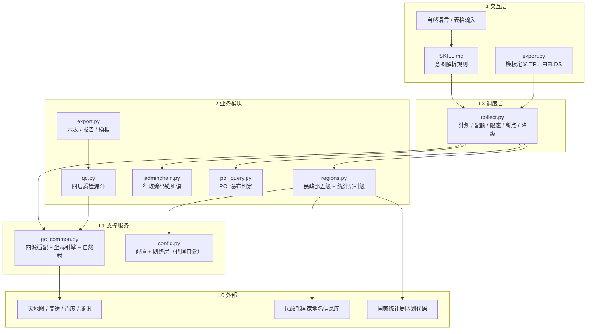
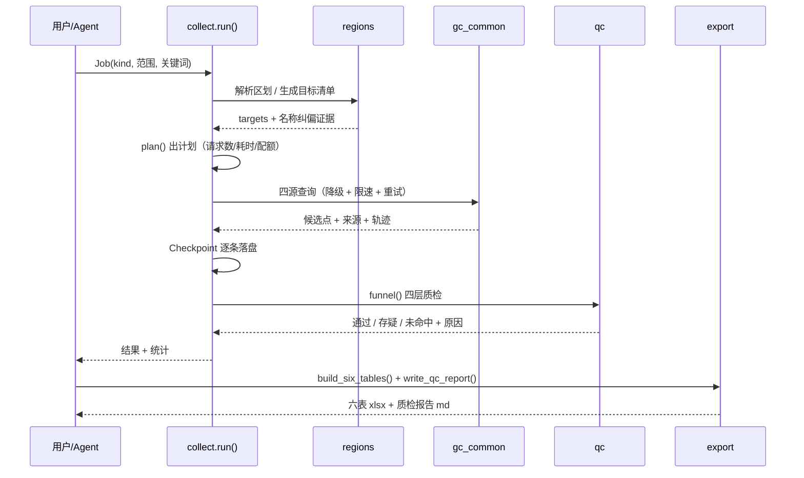

# 架构说明

> 面向**要改代码、扩数据源、理解分层**的人。使用操作见 [`使用手册.md`](使用手册.md)，
> 规则与判据见 [`../references/`](../references/)。

---

## 1. 定位

本仓库是 **「AI 技能包 + Python 库」**：

- **技能包身份**：`SKILL.md` 是给 Agent 的指令层（触发条件、执行纪律、硬约束），
  `references/` 是它的按需加载资料（渐进披露）。
- **库身份**：`scripts/` 是可独立调用的 Python 模块，不依赖 Agent 也能跑。

不提供 GUI、不提供 HTTP 服务、不落数据库——**一条命令或一段 Python 脚本就是全部入口**。

---

## 2. 分层架构



| 层 | 职责 | 脚本 |
|---|---|---|
| **L4 交互层** | 自然语言 / 模板 → 结构化任务 | `SKILL.md`（意图规则）+ `export.py`（模板定义） |
| **L3 调度层** | 编排 / 配额 / 限速 / 断点 / 降级 | `collect.py` |
| **L2 业务模块** | 区划 / 编码 / POI / 质检 / 输出 | `regions.py` `adminchain.py` `poi_query.py` `qc.py` `export.py` |
| **L1 支撑服务** | 四源适配 / 坐标引擎 / 几何 / 缓存 / 错误分级 | `gc_common.py` `config.py` |
| **L0 外部** | 四家图商 API + 民政部 + 统计局 | 见 [`references/四源接口对照表.md`](../references/四源接口对照表.md) |

功能编号 F1–F12 与模块、脚本、状态的映射见
[`references/功能模块映射表.md`](../references/功能模块映射表.md)。

---

## 3. 一条任务的数据流



关键约束：**断点即事实**——每条结果一落盘就写 `.jsonl`，中断后跳过已完成键；
**计划先行**——`plan()` 先算请求数与耗时，超日配额直接告警，不让用户跑到一半才发现跑不完。

---

## 4. 关键设计取舍

| 设计 | 取舍 | 理由 |
|---|---|---|
| 零重型依赖 | 只用标准库 + `pyproj` + 可选 `openpyxl` | 分发环境常装不上库；Excel 输出保留纯标准库 OOXML 路径 |
| 输出三级降级 | openpyxl → 纯标准库 xlsx → CSV | 三种形态列名与内容完全一致，只是载体不同 |
| 必填满 | 每条输入必出一行 | 用户明确要求：不许留空、不许只交最确认的几条 |
| 原文件只读 | 模板回填输出到新文件 | 不污染用户输入 |
| 双坐标输出 | 明细必带 WGS84 + GCJ-02 | 用户可在高德地图直接取点核对（闭环验真） |
| 空间闸门在客户端 | `spatial_gate_m` 默认 30 km | 图商 `mapBound` 实测无效，只能自己筛 |
| 4xx 不重试 | 永久错直接放弃 | 参数错误重试只会白烧配额与时间（实测占总耗时 64%） |
| 验真成本 ∝ 风险 | 高风险定向验真，低风险抽样 | 全量验真成本不可接受，抽检才可规模化 |
| 自适应抽检 | 5% / 2% / 15% 三档 | 固定抽样率在数据质量变化时会失真 |
| 存疑只标注不裸改 | 标来源 + 原因 + 建议动作 | 图商标注本身互相矛盾时，改坐标等于伪造精度 |
| 质检与交付双阈值 | `qc.py` 300 m 分级 / 报告 100 m 达标 | 避免「质检合格」被误读成「交付达标」 |
| 网络失败显式告警 | `RuntimeWarning` + `_LAST_NET_ERROR` | 防止「没查成」被当成「图商没有」 |
| 编排留在技能层 | 引擎只提供 Job/run 与适配函数 | 任务派发策略属于 Agent 职责，引擎保持可独立调用 |

**实现范围**：四源降级覆盖政府驻地与地址转坐标；POI 区内 / 周边两模式固定走高德。
模板 6 种任务类型中，`collect` 直接支持 4 种（见 [`使用手册.md`](使用手册.md) §6）。

---

## 5. 本地存储布局

```text
data/                       运行后生成，全部 .gitignore
├── regions/                区划缓存（民政部 json + 统计局村级 csv）
├── checkpoints/<任务ID>.jsonl   断点，逐条落盘
└── golden_natural.csv      用户核过的自然村黄金样本（人工确认后写入）
output/                     六表与质检报告（默认输出目录）
```

> `data/` 不进仓库：区划缓存可重新抓取，黄金样本含用户实测坐标，属于用户数据。

---

## 6. 扩展点

### 6.1 新增数据源（四处都要改）

1. `scripts/config.py`：Key 名、环境变量、日配额、QPS
2. `scripts/gc_common.py`：适配函数 + `FALLBACK_ORDER` + 坐标归一
3. `references/四源接口对照表.md`：能力、坐标系、必踩坑、限速
4. `SKILL.md`：能力边界与前置条件

### 6.2 新增任务类型

1. `collect.py`：写 `collect_xxx()`，加进 `_HANDLERS`
2. `export.py`：若需新列，改 `OUT_FIELDS` 并在 `build_six_tables` 里处理
3. 模板枚举：`export.py: TASK_TYPES`
4. `SKILL.md` + `references/准确率与质检口径.md`：任务类型与承诺

### 6.3 新增/修改判据

- **必须先读** [`references/实测案例与归因.md`](../references/实测案例与归因.md) 的「已证伪的改法清单」
- 必须用同一批回归样本对比改前/改后达标率，并附样本量
- 变差即回退，并把反例写回文档

---

## 7. 兼容性

- Python 3.10+（CI 覆盖 3.10 / 3.12）
- Windows / macOS / Linux；路径用 `pathlib`，无平台硬编码
- 网络：支持系统代理，`GDC_PROXY` 可显式指定；失效代理自动跳过；HTTPS 默认严格校验证书

---

## 8. 已知限制与后续计划

当前版本的已知限制（POI 两模式仅高德、网络失败归「未命中」、6 类任务与 4 个 `Job.kind`、
双阈值等）见 [`../README.md`](../README.md#️-已知限制--known-limitationsv111)。

v1.2 计划（未承诺时间）：

1. POI 区内 / 周边接入多源降级；
2. 增加独立「请求失败」状态，与「未命中」彻底分离；
3. 提供 `scripts/run.py` 一体化入口（读模板 → 派发 → 六表），当前由技能层编排；
4. 把 `config.py` 中的 `qc.*` / `checkpoint_every` 等参数真正接入实现。
